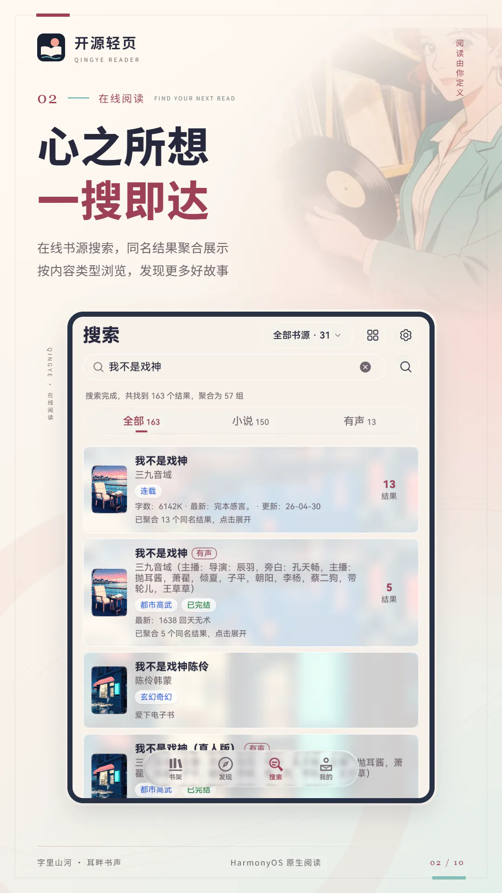
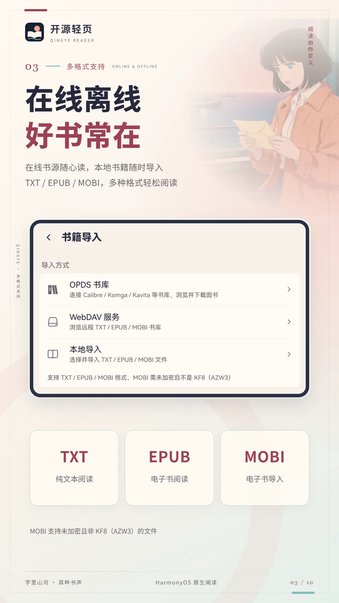
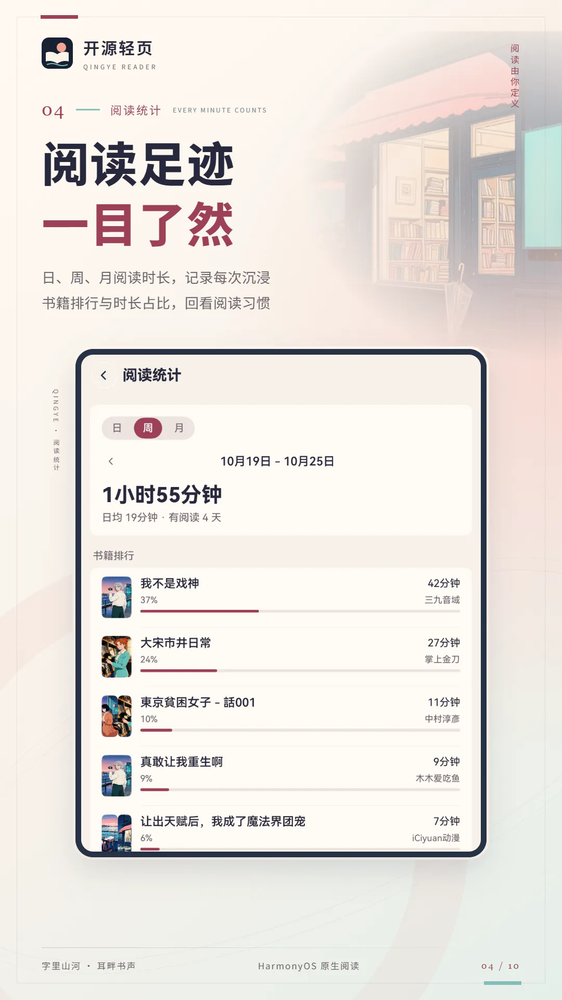
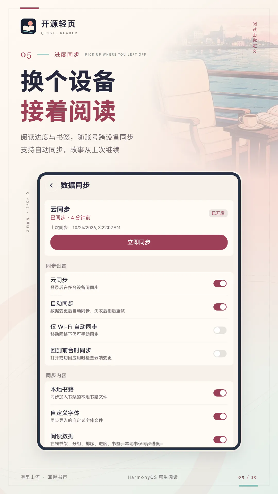
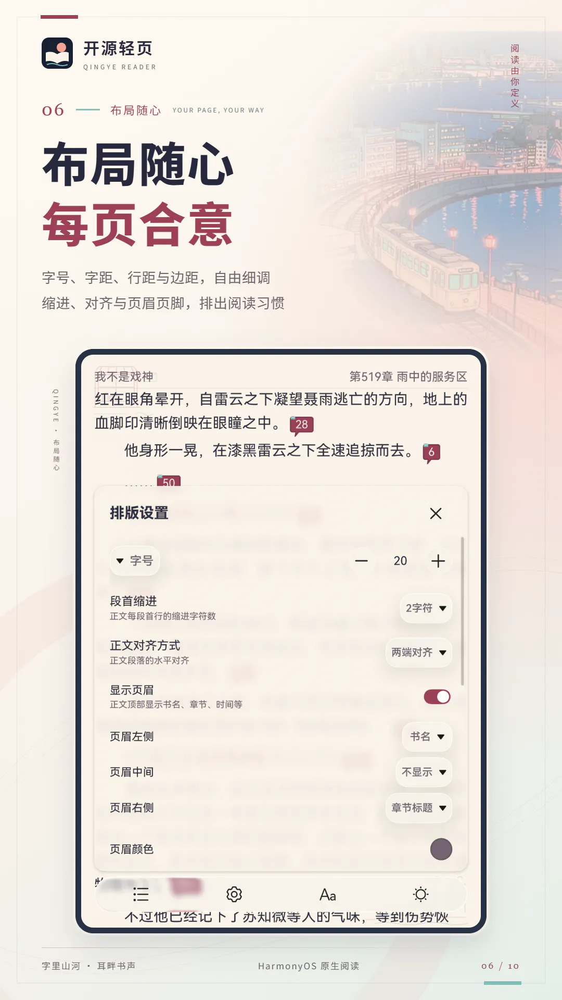
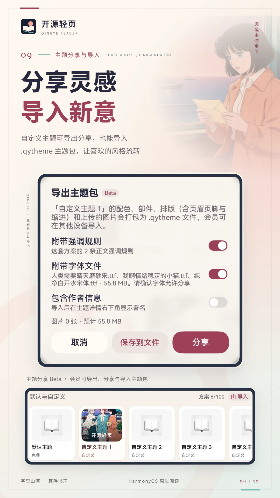

# 开源轻页

[](LICENSE)
%2B-black.svg)


开源轻页（qingye-reader）是一款使用 ArkTS / ArkUI 开发的 HarmonyOS NEXT 原生阅读应用，使用自有的原生书源格式并兼容 Legado（阅读）书源规则，面向手机、平板和 PC/2in1，提供书架、搜索、发现、书源管理、正文阅读、漫画、有声书、视频、朗读与个性化设置。

> [!IMPORTANT]
> 本项目不内置、不托管、不分发小说正文、章节、封面、付费资源或书源订阅。应用仅处理用户自行导入且具备合法使用权限的书源规则与本地文件。使用前请确认内容授权、目标站点协议及所在地法律法规要求。

<p align="center">
  <a href="docs/manual/shots/01-shelf.webp"></a>
  <a href="docs/manual/shots/02-search.webp"></a>
  <a href="docs/manual/shots/03-formats.webp"></a>
  <a href="docs/manual/shots/04-stats.webp"></a>
  <a href="docs/manual/shots/05-sync.webp"></a>
</p>
<p align="center">
  <a href="docs/manual/shots/06-layout.webp"></a>
  <a href="docs/manual/shots/07-comic.webp"></a>
  <a href="docs/manual/shots/08-voice.webp"></a>
  <a href="docs/manual/shots/09-theme-share.webp"></a>
  <a href="docs/manual/shots/10-theme.webp"></a>
</p>

| 项目 | 信息 |
| --- | --- |
| 应用包名 | `io.legado.read` |
| 当前版本 | `4.4.930`（以 `AppScope/app.json5` 为准） |
| 支持设备 | `phone`、`tablet`、`2in1` |
| 最低 / 目标 API | HarmonyOS 6.0.0（API 20）/ API 26 |
| 开源协议 | GPL-3.0 |

## 目录

- [功能概览](#功能概览)
- [快速开始](#快速开始)
- [书源规则兼容](#书源规则兼容)
- [项目结构](#项目结构)
- [开发与构建](#开发与构建)
- [调试](#调试)
- [已知限制](#已知限制)
- [文档](#文档)
- [合规与免责声明](#合规与免责声明)
- [许可证](#许可证)

## 功能概览

### 书架与本地书籍

- 统一管理普通书、漫画、有声书和视频：继续阅读、分组、排序、置顶、换源和批量操作，封面角标区分类型。
- 书架顶部按类型分类（全部、小说、漫画、有声书、视频，只显示有书的类型），分组从标题下拉切换。筛选支持来源、连载状态、阅读进度、有更新、最近阅读时间、标签和书源；同组多选取并集，不同组取交集。
- 从筛选菜单打开“搜索书架”，按书名、作者、书源或标签查找已有书籍，可与分类、分组和筛选条件叠加。
- 隐私书架：从最后一个分类继续左滑进入，可设密码，隐私书籍不出现在桌面卡片、最近阅读快捷方式、局域网阅读和阅读统计中。
- 平铺、紧凑、宽松三种布局，可显示封面、简介、标签、阅读进度、最新章节和更新时间；平铺布局的“上次阅读置顶”可选关闭、中（跨两列的展开书本）或大（占满一行的继续阅读卡片）。
- 「我的 → 书籍导入」统一提供本地导入、OPDS 书库和 WebDAV 服务三个入口；本地导入可一次多选 TXT/EPUB/MOBI（MOBI 支持未加密的 MOBI6，按原书目录分章并提取封面），使用应用自身的文件访问能力，不扫描公共目录。
- 指定章节范围缓存或全文后台缓存，以可取消的后台通知任务执行。
- 缓存带容量上限：阅读和预缓存顺带写入的正文最多 256 MiB、漫画图片最多 1 GiB，超出后按最久未用清理；手动缓存的章节、本地书正文和正在阅读的书不会被自动清理。「其他设置 → 缓存」可查看占用并手动清理。
- 后台静默检查连载更新并在封面显示“新”角标；支持最近阅读、阅读统计和桌面快捷项。
- “最近阅读”服务卡片提供 2×2、2×4、4×4 尺寸：主推最近一本，附最近阅读列表、阅读进度和具体阅读时间。

### 搜索与发现

- 对已启用书源并发搜索、增量出结果，支持停止、精准搜索、作者匹配、分组筛选和单书源搜索；单个书源超过 60 秒未完成即放弃并让出并发槽。
- 搜索结果按小说、漫画、有声、视频分段查看，各类型分别计结果上限；同名结果可聚合，且不跨类型合并。
- 搜索范围为左右分栏的半模态面板：左栏按全部、已选和分组三态勾选，右栏可搜索、全选、反选，上千书源也能流畅勾选；发现页书源下拉与它共用同一套书源选择样式和长按操作。
- 发现页读取书源的站点、分类和榜单入口：书源从弹出层选择（可搜索、按分组切换），模式与站内分类合并为一条频道栏，筛选条件收进筛选按钮。分类较多时可打开“全部分类”面板，按分组浏览或搜索，记住每个书源的最近使用和上次停留分类；首次打开后常驻，切换页签回来不重新加载，结果带缓存。
- 搜索页未搜索时直接列出搜索历史；搜索与发现结果可切换列表或平铺（平铺列数随宽度自适应），列表行以模糊封面作底。书架、发现、搜索列表上滑时收起标题行。
- 详情页以封面氛围背景展示书籍信息，图标操作行提供加入书架、目录/选集、换源和同作者；可直接查看完整目录、点击作者搜索、换源（并发数跟随搜索并发数设置）；有声书直接进入听书页。未入库的书也能临时试读，退出时再决定是否加入书架。

### 书源管理

- 从 URL、剪贴板、本地 JSON/文本文件或系统“打开方式”导入；可一次选择多个文件，合并后统一勾选写入，读取失败的文件单独跳过并提示文件名。
- 导入保留标准字段、原始 JSON 和未知字段，导出时合并，尽量保持与 Android 阅读的往返完整性。
- 编辑、分组、锁定、导出、删除，以及批量启用/禁用搜索与发现；列表可按全部、原生、兼容筛选。原生书源有独立的编辑页和“书源设置”页（变量、音色、账号登录、动作按钮），书源管理和发现页的长按菜单都能进入。
- 原生书源支持 QuickJS 函数库与后台脚本阶段，可组合请求、保存变量和登录凭据、弹出提示、刷新发现缓存，以及打开网页验证。设置页支持脚本提供动态选项、按钮执行状态和多步登录。漫画与插图可按标准算法（含 `ivPrefixBytes`、`keyEncoding`）或后台运行的图片字节脚本解密，封面支持 `coverDecode` 与 `coverHeaders`。
- 两种校验模式（搜索能力、发现/阅读链路），结果区分“通过、失败、无结果、需要验证、暂时异常”，只有明确失败项可批量禁用或删除。
- 单书源调试页可按搜索、发现、详情、目录、正文或全链路运行，查看请求、规则匹配、输出和错误，并导出脱敏报告。
- 支持动态 `loginUi`、登录检测 JS、网页验证、同站点 Cookie 同步和登录状态持久化；证书错误可由用户按精确主机选择信任。
- 请求遇到域名解析失败、超时等网络错误时直接显示真实原因，不误报“需要登录或验证”；书源脚本在详情、目录、正文阶段弹出的提示在应用内显示。

### 阅读

- 自研 V2 排版引擎：原生段落测量、增量分页、文本选区、正则样式和朗读高亮；进度按字符偏移保存和恢复。
- 上下滑动、横向滑动、滚动阅读和横屏双页；横向翻页可选无动画、平移、淡入、叠页、仿真和 3D 仿真（从页角拖动时纸角跟随手指），翻页模式下末行对齐版心底边。
- 页眉页脚按槽位自定义：书名、作者、章节、页码、剩余页数、进度百分比、时间和电量，可加本章或全书进度条，并可调节页眉下移、页脚上移的距离。
- 字号、字重（九档，正文与正则样式都生效）、行距、段距、边距、对齐方式、自定义字体、背景、深色模式、沉浸式布局和段首缩进；上下边距可调到 0，正文紧贴页眉页脚。
- 阅读设置分两层：第一层是小说与漫画共用的外观、操作和其他设置，小说排版、背景、翻页在子页，漫画另有设置页（阅读方式、画面与漫画超分）。
- 书签、章节评论/段评、替换净化（可直接导入 Android 阅读与 YueDu 导出的规则，Java 正则自动转换；每条规则带超时保护，超时跳过并保留原文）。
- EPUB 图文混排：随文图片与整页插图分别排版；图片加载时原位显示加载动画，本地插图解码后保留在内存，翻页与跨章不再闪白。
- 网络正文插图先下载到本地缓存再显示，避免远程图片地址直接交给图片组件后持续空白。
- 分卷第一章在章节名前显示卷名小标题和卷首插图；正文首行与章节名重复时自动去掉。
- 滚动阅读与漫画条漫的列表接上相邻章节，向下或向上滚过章节边界都会自动切换当前章，无需下拉或上滑加载。
- 漫画专用阅读界面：条漫或单页翻页（从左往右、从右往左，宽屏自动双页），阅读方式按书保存；画面设置可调背景、页间距、适应宽度/屏幕、信息条和预加载张数；双击与双指缩放；长按图片保存、分享或重新加载，图片地址过期时自动重新获取本话。支持携带书源请求头、Cookie 或解密规则的远程图片；单张图片下载或解密失败只在原位显示原因，不影响整章。
- 漫画超分（会员专享，API 26 起）：用系统端侧图片超分把屏幕上的漫画放大到显示宽度的 2 倍，长条漫分块处理后拼接，失败时继续显示原图。
- 漫画文字识别：长按图片选择“查看本页文字”，在设备本地识别并复制原文；“繁→简”预览与漫画画面设置中的“AI翻译 → 繁→简”为会员功能，纯色气泡内的繁体对白会在原图上覆盖显示简体，复杂背景保留原样。需要设备支持系统 OCR；日文、英文、韩文目前仅识别；AI翻译下拉菜单中的日→中、韩→中标记“即将推出”，暂不可选。
- 本地漫画着色（会员专享；北京时间 2026-11-01 00:00 前，AI 着色、AI 超分与 AI 翻译向所有登录用户免费开放）：阅读器“画面设置 → AI着色”，按书记忆开关。翻页模式优先当前跨页并预取后两跨页；条漫优先可见画面、沿滚动方向预取约两屏。关闭开关恢复原图；长按“本页着色”可单独处理一张。支持的设备和页面自动使用 NNRT 加速，不支持或校验失败时回退 CPU；原生像素合成已接入，麒麟 9030 Pro 的测试页连续着色约 2.1～2.2 秒，首次加载与校验较慢。内置一个 CPU、两个 NPU 专用 AlacGAN 模型，原始资源合计约 176.25 MiB，图片不上传，与漫画超分共用会员规则及串行计算队列。单张超过 4:1 的超长图仍保留原图。测量范围和设备边界见 [漫画着色](docs/comic-colorizer.md)，阅读行为见 [彩色阅读交互](docs/comic-color-interaction.md)。
- 漫画图片逐张下载、解密并显示，优先处理屏幕上的图片；预加载与全文缓存共用有上限的调度队列，单图失败不阻塞其他图片。原生书源图片脚本支持 `image.reorderStrips` 条带重排。
- 段评与本章说显示为跟随主题的数字气泡；深色模式下的评论网页自动反色。
- 可选的本地眼动翻页：注视底部后向上看即可翻页，相机画面仅在设备内处理，不上传、不保存。

### 朗读与有声书

- 系统 TTS 与自定义 HTTP TTS，支持语速、定时停止、章节切换、后台朗读和系统媒体控制；翻页和滚动阅读都显示当前句高亮，滚动模式自动跟随朗读位置。
- 可导入原版 `HttpTTS` JSON，也可在应用内新建、编辑和排序自定义音色。
- 有声书使用独立远程播放器，支持进度、倍速、目录跳转、定时停止和音色代码；切章时按钮不锁定，获取音频地址超过 30 秒报超时，取不到地址时显示书源给出的原因。
- 朗读与听书可在返回书架或进入后台后继续，通过全局播放胶囊与 AVSession 控制；快速朗读与听书面板采用封面氛围背景、大播放键和底部功能栏。在书架上展开的朗读面板可“回到正文”，重新打开该书并接上正在进行的朗读。蓝牙或有线耳机断开时自动暂停朗读。
- 视频类书籍（如短剧）使用独立播放页，详情页提供选集。

### 局域网阅读、OPDS 与 WebDAV

- 在 App 内启动局域网浏览器阅读服务，同一局域网的浏览器可查看书架、搜索、发现并阅读小说或漫画，章节进度同步；可设置访问密码（加密存储，连续输错会暂时锁定）。
- 添加 Calibre、Komga、Kavita、talebook 等 OPDS 书库（不预置任何服务器地址），支持目录浏览、站内搜索、Basic / Digest 认证（自动协商）与网页登录；入口连不上时自动换尾斜杠写法或补 `/opds` 重试，Kavita 可用账号密码自动获取 OPDS 地址，下载的 EPUB/TXT/MOBI 作为本地书导入。
- 添加 WebDAV 服务并指定书籍目录，支持 Basic / Digest 认证和匿名访问，可浏览、上传、新建文件夹、重命名和删除，下载 TXT/EPUB/MOBI 到书架。

### 数据、同步与个性化

- 应用数据本地备份/恢复（可选加密）和账号云同步；本地书籍通过内容指纹跨设备匹配，只同步进度，不上传正文；可查看、改名和移除同步设备。“同步问题”页记录整次同步失败、云端拒收的条目和文件上传失败，书源类问题可直接打开或删除该书源。
- 会员与账号：会员档位、点数充值与会员方案合在「会员与账号」页，「我的权益」页领取每月朗读字数礼包并查看权益；会员昵称按档位配色并显示档位图标；终身会员起可用动态头像，终身超级会员另有云空间（自定义字体与本地书籍自动上传，换设备后以占位书和置灰字体出现，点按即下载）和专属主题“曜金藏书”。服务端配置与部署见 [server/README.md](server/README.md) 和 [配置示例](server/.env.example)。
- 华为账号登录后自动带入昵称和头像（不覆盖应用内改过的资料），点数与主题权益跨设备同步。
- 浅色/深色模式、按钮色、强调色、自定义字体、阅读背景、封面图库和应用图标；全局字体默认“跟随系统”，在系统里换字体后回到应用即生效；主题页集中展示当前使用、默认与自定义方案、已购主题和更多主题，可在详情页预览、试用或获取。主题自带书籍封面、启动封面、书架文件夹插画、朗读/有声书面板背景和段评气泡样式。
- 书架、发现、搜索的顶部控件、下拉菜单与目录弹层在 API 26 及以上使用系统沉浸光感材质，旧系统退回半透明磨砂；二级页面的顶栏随内容上滑收起、下滑展开。
- 自定义主题分享 Beta（会员专享）：导出、分享或导入 `.qytheme`，包含配色、部件选择、阅读排版和用户素材；导入前预览内容，未获得的内置主题部件回退到默认样式。
- 「我的」页右上角可切换显示模式；页眉与页脚分别设置字号、不透明度、颜色和左右收缩，段首缩进支持 0–4 字符。
- 「我的 → 帮助」可离线查看随应用打包的使用说明书。

本次发布说明见[更新日志](CHANGELOG.md)，包含 926 之后的累计更新与 928 之后的增量更新。

## 快速开始

1. 使用 DevEco Studio 打开项目，配置 HarmonyOS SDK 与本地签名。
2. 构建并安装 `entry` 模块。
3. 进入「我的 → 书源管理」，导入自有或已获授权的书源 JSON，并先执行书源校验。
4. 在「搜索」或「发现」中查找书籍，加入书架后开始阅读。
5. 阅读本地文件时，进入「我的 → 书籍导入 → 本地导入」，选择一个或多个 TXT/EPUB/MOBI 文件；也可在同一页面从 OPDS 书库或 WebDAV 服务下载。
6. 在阅读页呼出菜单，调整排版、翻页、主题、预缓存与朗读设置。
7. 各项功能的用法见「我的 → 帮助」或[使用说明书](docs/manual/index.html)。

## 书源规则兼容

兼容层覆盖 Android 阅读书源的常用写法，但不是完整的 Android Java/WebView 环境。当前重点支持：

| 类别 | 能力 |
| --- | --- |
| 请求 | HTTP GET/POST、请求头、请求体、URL 模板、字符集、重试、Cookie 注入与 `Set-Cookie` 保存；`header` 可用 `@js:` 动态计算；URL 选项支持显式 `session` 会话规则。 |
| 网页抓取 | URL 选项 `webView: true` 改走隐藏 ArkWeb 并返回渲染后的 DOM，`webJs` 可在页面上下文生成最终响应。 |
| 解析 | JSONPath、CSS、基础 XPath、旧式链式规则、属性提取、`&&` / `\|\|` / `%%` 组合、模板拼接、`##` 正则后处理（兼容 Java 正则方言）、`@put` / `@get`。 |
| JavaScript | `<js>` / `@js:` 混合规则与 `jsLib`；轻量兼容引擎处理常用表达式，复杂脚本按搜索、发现、详情、目录、正文阶段路由到受控 ArkWeb；原生 QuickJS 以影子比对和灰度方式逐步接管纯表达式。 |
| 主机函数 | 常见 `java.*`、`source.*`、`book.*`、`cache.*`、`cookie.*`，以及 Base64、Hex、摘要、URL/HTML 编解码和 AES/DES/3DES；`java.toast` 在阅读阶段显示为应用内提示。 |
| 登录 | 动态登录面板、`startBrowserAwait`、登录页脚本、验证码跳转和跨地址 Cookie 同步。 |
| 内容类型 | 普通文本、漫画、有声书识别；正文中的显式网页操作、图片和媒体标记；`data:` / Base64 地址。 |

以上是兼容书源（Android 阅读格式）的能力，这种格式已过时，仅为存量书源保留。新书源推荐使用开源轻页的原生格式：声明式规则、表达式与 `lib` 函数库负责常规解析，顶层 `js` 提供 JavaScript 函数；需要按程序组织请求时，在相应阶段声明 `script: "函数名"`。

| 原生 JS 用法 | 执行方式与边界 |
| --- | --- |
| 表达式调用 `js` 函数 | 在 `= sign(...)` 或 `{{sign(...)}}` 中按名调用，用于签名、解密和数据整理。主线程同步 QuickJS，只做计算，不支持异步返回、网络或状态写入；单次调用最多 300 ms。 |
| 阶段 `script` | 搜索、发现、详情、目录、正文可交给后台 QuickJS；通过 `http`、`vars`、`cache`、`cookie`、`login` 等受控接口执行请求和保存状态，返回值继续交给选择器与字段规则处理。默认每次最多 30 个请求、计算 2 秒、总时长 60 秒。 |
| 设置与交互 | `login.script`、`login.sendCode.script`、`actions[].script` 和 `vars[].optionsScript` 使用同一后台脚本能力。轻页已接入 `ui.toast`、`ui.refreshExplore`、`browser.verify/open`；搜索和发现中的验证需由用户点“去验证”后重试。 |

原生书源还支持视频播放页、听书音色列表、分卷、目录与正文的声明式列表分页并发抓取（正文最多 200 页）、附加请求、漫画图片解密和加密封面解密（`coverDecode`）。目录或正文启用 `script` 后，分页由脚本处理，不再跟随 `nextUrl`。原生 JS 与兼容书源的 QuickJS 影子/灰度迁移是两条独立路径，无需开启迁移模式才能使用。

书源规则由书源解析内核 [harmony-book-source-engine](https://github.com/wip3l/harmony-book-source-engine) 实现，开源轻页与简听共用同一份规则定义。

两种格式的完整字段、请求格式、解析语法、调试方法和迁移建议见子模块中的[公共书源开发文档](harmony-book-source-engine/docs/book-source-development.md)：第一部分是原生书源，第二部分是兼容书源。轻页的接入情况与 JS 开发路线见[本项目书源开发入口](docs/book-source-development.md)；本地文档随当前内核提交固定，在线主分支可能更新得更快。

## 项目结构

```text
qingye-reader/
├── AppScope/                         # 应用级配置与资源
├── entry/                            # 主应用模块
│   └── src/main/ets/
│       ├── account/                  # 华为账号、云同步与云端朗读
│       ├── components/               # 通用 ArkUI 组件
│       │   ├── common/               # 二级页面骨架 PageScaffold 与设置行 SettingRow
│       │   ├── home/                 # 首页各页签：书架、发现、搜索、我的
│       │   └── reader/               # 阅读页面板：目录、缓存、排版、配色、朗读控制、眼动校准
│       ├── core/
│       │   ├── book/                 # 搜索、发现、详情、目录和正文协调
│       │   ├── concurrency/          # 正文预处理等耗时任务
│       │   ├── lan/                  # 局域网浏览器阅读服务
│       │   ├── reader/               # 阅读器排版引擎与阅读页控制器
│       │   └── stats/                # 阅读统计
│       ├── entryability/             # 应用入口 Ability
│       ├── entryformability/         # 桌面服务卡片 Ability
│       ├── model/                    # 数据模型与本地数据库
│       ├── opds/                     # OPDS 目录解析与下载
│       ├── pages/                    # 页面与设置界面
│       ├── theme/                    # 主题模型、注册表、运行时令牌，以及字号 / 间距档位
│       ├── utils/                    # 设置、缓存、字体、TTS 与音频工具
│       ├── webdav/                   # WebDAV 书籍浏览与下载
│       └── widgets/                  # 桌面服务卡片界面
├── harmony-book-source-engine/       # 子模块：书源解析内核（独立公开仓库，GPL-3.0）
│   ├── sourceengine/                 # 内核 HAR，包名 @legado/sourceengine；QuickJS 诊断另由 Diagnostics.ets 导出
│   │   └── src/main/ets/core/        # book / concurrency / http / nativesource / rule / script
│   ├── quickjs/                      # 修改版 ohos_quickjs 原生模块
│   └── scripts/                      # 内核自己的回归检查
├── harmony-book-ai-engine/           # 子模块：AI 引擎（着色、OCR、翻译、超分与模型）；会员权益，私有仓库，不在本仓库开源
├── docs/                             # 开发文档与使用说明书网站（docs/manual）
└── scripts/                          # 构建前与架构回归检查
```

主要模块：

| 模块 | 职责 |
| --- | --- |
| `SearchCoordinator` / `ExploreCoordinator` | 搜索与发现的并发、进度、解析和结果汇总。 |
| `WebBookService` / `ReadBookEngine` | 详情、目录、正文、缓存和阅读状态。 |
| `AnalyzeUrl` / `AnalyzeRule` | 请求描述、选择器、正则与脚本规则解析。 |
| `JavaRegexCompat` / `BudgetedRegexReplace` | Android 正则方言转换（含 `\w`、`\d`、`\b` 的 Unicode 语义），以及带时间预算的净化替换。 |
| `BookSourceRuntimeRouter` / `BookSourceStageWebRuntime` / `BookSourceHeaderRuntime` | 复杂 JavaScript 的分阶段运行、受控桥接与 `@js:` 动态请求头。 |
| `QuickJsScriptRuntime` / `QuickJsRuntimeStatus` | QuickJS 自检、资源限制和纯表达式影子比对。 |
| `NativeJsLibrary` / `NativeScriptSessions` / `NativeScriptHost`（内核） | 原生书源 JS 函数库、后台脚本会话、宿主接口与执行预算。 |
| `AppSourceInteraction` / `NativeSourceSettings` | 原生脚本提示、发现缓存失效、网页验证，以及设置页动态选项、登录与动作按钮。 |
| `WebBookFetchRuntime` | 书源显式声明的 `webView: true` / `webJs` 页面抓取。 |
| `BookSourceLoginWebRuntime` | 登录面板、WebView、Cookie、加密和状态持久化。 |
| `ReaderV2Document` / `ReaderV2Paginator` / `ReaderV2RenderNode` / `ReaderV2Interaction` | 阅读器 V2 文档建模、增量分页、原生选区、动作命中和朗读高亮。 |
| `ReaderEmulationFlipPainter` | 仿真与 3D 仿真翻页绘制。 |
| `ReaderFullTextCacheController` / `ReaderTtsMediaSession` / `ReaderEyeTurnCoordinator` / `ReaderPageTurnQueue` | 全文缓存任务、朗读后台与媒体会话、眼动翻页流程和翻页排队。 |
| `FullTextCacheCancelCoordinator` | 把通知栏取消动作关联到具体全文缓存任务，并中止活动请求与规则解析。 |
| `SystemTtsReader` / `HttpTtsReader` / `RemoteAudioPlayback` | 系统朗读、HTTP TTS 与有声书播放。 |
| `EyeTurnController` / `ArEngineEyeTracker` | 本地人脸/眼部采样、校准和翻页判定。 |
| `HttpAuth` / `OpdsKavita` | OPDS 与 WebDAV 共用的 Basic / Digest 认证协商；Kavita 网页地址识别与登录换取 OPDS 密钥。 |
| `PageScaffold` / `SettingRow` | 二级页面的统一顶栏、底色、安全区留白和滚动容器；设置页的开关行、跳转行与下拉行。 |
| `ThemeRuntime` / `AppFontSize` / `AppSpacing` | 主题色与圆角令牌，界面字号 7 档、间距 8 档。 |
| `ImmersiveMaterialSurface` / `ImmersiveMaterialRuntime` | 借 HdsTabs 悬浮栏承载系统沉浸材质与触摸光晕；弹出层、半模态弹层的材质配置，以及玻璃标签 `GlassTagModifier`。 |
| `CoverBackdropCard` | 搜索与发现结果行的模糊封面底，封面地址变化时重绘，高度取内容实测值。 |
| `WebRuntimeAvailability` | 挂载隐藏 ArkWeb 宿主前探测 Web 能力，缺失时不挂载。 |
| `LanReaderServer` | 局域网浏览器阅读服务：会话令牌、登录失败锁定、Host/Origin 校验和图片代理的内网地址过滤。 |
| `ReaderOpenTrace` | 从书架点击到阅读首屏的阶段耗时记录。 |
| `BookCoverCache` | 封面下载、缓存与并发限制；带 `SourceCoverUrl` 标记的加密封面经内核 `SourceCoverLoader` 解密后落盘，界面在解密完成前显示占位，局域网阅读转发的也是解密后的图片。 |
| `AppDatabase` | 书源、书籍、章节、搜索历史、分页缓存和本地配置；启动时通过 `BookSourceRuntimeStore.install` 注入内核，内核本身不访问数据库。 |
| `NativeSourceRunner` / `NativeSourceService`（内核） | 原生书源各阶段执行与请求层接入；轻页不安装内核的可选宿主端口 `SourceEngineHost`。 |

轻页在启动时独立安装 `NativeSourceInteraction` 界面处理器；它与上表中的可选 `SourceEngineHost` 适配器不是同一个接入点。

## 开发与构建

### 环境要求

- DevEco Studio，HarmonyOS SDK `26.0.0`（API 26）
- ArkTS / ArkUI，hvigor
- Node.js（运行回归脚本）

| 配置 | 值 |
| --- | --- |
| 主模块 / 入口 Ability | `entry` / `EntryAbility` |
| `versionName` | `4.4.930` |
| `versionCode` / `buildVersion` | `4040930` |
| `minAPIVersion` / `targetAPIVersion` | `20` / `26` |
| 权限 | `INTERNET`、`GET_NETWORK_INFO`、`KEEP_BACKGROUND_RUNNING`、`CAMERA`（仅在用户启用眼动翻页时请求） |

### 获取源码

书源解析内核 [harmony-book-source-engine](https://github.com/wip3l/harmony-book-source-engine) 与 AI 能力库 [harmony-book-ai-engine](https://github.com/wip3l/harmony-book-ai-engine) 均通过 Git 子模块接入。AI 着色、OCR、翻译、超分和后续 AI 实现在 AI 子库中开发，接入边界与流程见 [AI 子模块说明](docs/ai-engine.md)。

> [!NOTE]
> AI 引擎子模块 `harmony-book-ai-engine` 承载会员权益功能（漫画着色、超分、OCR 与翻译），是私有仓库，**不在本仓库开源**。没有访问权限时，克隆和 `git submodule update` 会在这个子模块上失败；主应用的 `entry` 依赖 `@legado/aiengine`，缺少它无法完成构建。

克隆时带上子模块：

```bash
git clone --recursive https://github.com/wip3l/qingye-reader.git
```

已经克隆过的仓库补拉子模块：

```bash
git submodule update --init --recursive
```

修改内核时在对应的 `harmony-book-source-engine/` 或 `harmony-book-ai-engine/` 内提交并推送，再回到本仓库提交子模块指向的新版本。AI 子库可独立运行 `npm --prefix harmony-book-ai-engine test`。

本项目要求完整推送：用户提出“提交并推送”或“推送”时，默认一并检查和处理主仓库及所有子模块的改动。先提交并推送子模块，确认提交已在远端后，再更新主仓库的子模块指针并提交、推送主仓库；最后核对两边远端提交、子模块指针和工作区状态。签名密码、私钥等敏感材料不得提交。

### 命令行构建

以下命令以 DevEco Studio 默认安装目录为例：

```powershell
$env:DEVECO_SDK_HOME = "C:\Program Files\Huawei\DevEco Studio\sdk"
```

构建调试 HAP：

```powershell
& "C:\Program Files\Huawei\DevEco Studio\tools\hvigor\bin\hvigorw.bat" `
  --mode module -p module=entry@default -p product=default assembleHap --no-daemon
```

构建默认 APP：

```powershell
& "C:\Program Files\Huawei\DevEco Studio\tools\hvigor\bin\hvigorw.bat" `
  assembleApp --no-daemon
```

构建 release APP：

```powershell
& "C:\Program Files\Huawei\DevEco Studio\tools\hvigor\bin\hvigorw.bat" `
  --mode project -p product=release -p buildMode=release assembleApp --no-daemon
```

输出位置：

- 调试 HAP：`entry/build/default/outputs/default/entry-default-signed.hap`
- release APP：`build/outputs/release/<工程目录名>-release-signed.app`（本地目录为 `legado-harmony` 时，文件名是 `legado-harmony-release-signed.app`）

release 构建依赖本机有效的签名证书、Profile 和 keystore。请使用本地签名配置，不要向仓库提交私钥、证书密码或个人绝对路径；`build`、`oh_modules` 等中间目录也不应提交。

### 回归检查

```powershell
node scripts/neutral-source-engine-check.mjs
node scripts/thread-blocking-check.mjs
node scripts/theme-framework-check.mjs
node scripts/log-policy-check.mjs
node --experimental-strip-types scripts/opds-parser-check.mjs
node --experimental-strip-types scripts/opds-kavita-check.mjs
node --experimental-strip-types scripts/java-regex-compat-check.mjs
node --experimental-strip-types scripts/budgeted-regex-replace-check.mjs
node --experimental-strip-types scripts/replace-rule-import-check.mjs
node --experimental-strip-types scripts/reader-text-normalizer-check.mjs
node --experimental-strip-types scripts/reader-chunk-pagination-check.mjs
node --experimental-strip-types scripts/epub-converter-check.mjs
node --experimental-strip-types scripts/epub-mixed-layout-check.mjs
node --experimental-strip-types scripts/reader-info-bar-check.mjs
node --experimental-strip-types scripts/audio-rule-support-check.mjs
```

应用功能的其他检查同样用 `node --experimental-strip-types scripts/<脚本名>.mjs` 运行，见下表；`cloud-files-ui-check` 读取编译产物，需先执行一次 `assembleHap`。

书源解析内核的回归检查在子模块里（HTTP 认证、页码候选、原生书源、请求支撑、脚本运行时、图片解密、宿主端口等），用法见 [harmony-book-source-engine/README.md](harmony-book-source-engine/README.md)。原生 JS 相关检查可从本仓库根目录运行：

```powershell
node --experimental-strip-types harmony-book-source-engine/scripts/native-source-check.mjs
node --experimental-strip-types harmony-book-source-engine/scripts/native-js-check.mjs
node --experimental-strip-types harmony-book-source-engine/scripts/native-script-check.mjs
```

这些脚本使用 Node 替身验证规则和宿主协议；真机 QuickJS、线程响应和网页交互还应在“其他设置 → 兼容与诊断 → 脚本引擎迁移 → 后台脚本线程验证”及实际书源链路中检查。

```bash
for f in harmony-book-source-engine/scripts/*-check.mjs; do node --experimental-strip-types "$f" || exit 1; done
```

| 脚本 | 检查内容 |
| --- | --- |
| `neutral-source-engine-check` | 是否引入固定内容接口、默认凭据或站点专用后端。 |
| `thread-blocking-check` | 协作式调度、分页和运行时隔离约束。 |
| `theme-framework-check` | 主题注册、令牌和资源安全约束。 |
| `log-policy-check` | 日志策略：不把凭据类变量和完整请求地址写进日志。 |
| `opds-parser-check` | OPDS 目录、条目和 OpenSearch 描述的解析（基于 `scripts/opds-fixtures`）。 |
| `opds-kavita-check` | Kavita 适配：OPDS 地址识别、登录响应取密钥、展示时遮住密钥。 |
| `java-regex-compat-check` | Android/Java 正则方言到 JavaScript 的转换，含 `\w`、`\d`、`\b` 的 Unicode 语义。 |
| `budgeted-regex-replace-check` | 净化替换的逐行执行、跨行判定和超时放弃。 |
| `replace-rule-import-check` | 阅读/Legado/YueDu 替换净化规则的字段别名映射。 |
| `reader-text-normalizer-check` | 正文归一化与字符偏移到页码的映射。 |
| `reader-chunk-pagination-check` | 滚动阅读与漫画的分块规则，块边界不切开段评和图片标记。 |
| `epub-converter-check` | EPUB XHTML 到阅读器正文的转换、目录切章与图片标记。 |
| `epub-mixed-layout-check` | 图文混排的图片尺寸判定：随文排版还是整页插图。 |
| `reader-info-bar-check` | 页眉页脚槽位配置：旧设置迁移、损坏配置回退、槽位文字与进度计算。 |
| `reader-font-weight-check` / `reader-settings-persistence-check` | 正文字重档位与输入规范化；阅读设置排队保存后的持久化。 |
| `reader-emulation-fold-check` | 仿真翻页折线：上下角折线衔接、近边拖动、不同宽高比与前后翻页纹理对齐。 |
| `comic-image-pipeline-check` / `image-script-check` | 正文图片解密：逐图 IV、AES/3DES 各模式、明文与 HEIF 直通、缓存标识；图片字节脚本的隔离、限额、排队与取消。 |
| `obsidian-reader-bubbles-check` / `neon-harbor-check` | 主题应用后阅读页气泡与首字样式的完整链路，含深浅色、评论与章节绘制、书源覆盖和主题权益；后者覆盖“霓港来信”主题的注册与素材路由。 |
| `mobi-parser-check` | MOBI6 解析：PalmDOC 解压、正文尾部附加数据、filepos 目录、图片改写、封面与不支持格式的提示。 |
| `reader-cache-budget-check` | 正文与漫画缓存的清理计划：超限才清、按最久未用删到 90%、手动缓存与使用中的项跳过。 |
| `app-icon-check` | 备用桌面图标与主题图标：API 版本判断、失败重置、状态校正与并发切换。 |
| `collapsing-header-check` | 各页面 List/Scroll 回调驱动的顶栏收起。 |
| `book-source-position-check` | 书源置顶、置底、取消、拖动排序与事务回滚。 |
| `trial-read-shelf-check` | 试读后加入书架的生命周期：小说、有声等类型在保留、重开与保存后仍在书架。 |
| `cloud-auto-sync-check` / `cloud-transfer-check` / `cloud-font-import-check` / `custom-font-lifecycle-check` / `cloud-files-ui-check` | 云空间：字体与本地书籍自动上传、关联与两种删除、占位书和隐私书架排除；传输续传；云端字体命名与导入；自定义字体生命周期；云空间页的异步刷新。 |
| `membership-gift-check` / `membership-purchase-check` / `membership-theme-check` / `animated-avatar-check` | 会员：礼包档位与历史领取；购买恢复、重试与账号切换；会员主题授予与回收；动态头像的原始字节、裁剪与权益。 |
| `audio-rule-support-check` | 有声书规则辅助：`sourceRegex`（Java 方言、字面量、响应体捕获组）、地址携带的请求头、跨站请求头收敛、`@webjs:` 识别。 |

这些脚本用于代码回归，不能替代授权审查、安全审计或法律意见。

## 调试

书源管理中的“调试”可针对单个书源运行指定阶段或全链路，执行明细会显示网络请求、响应摘要、规则类型、匹配数量、耗时和错误，并可导出脱敏 JSON 报告。详见书源开发文档的[单书源调试](https://github.com/wip3l/harmony-book-source-engine/blob/main/docs/book-source-development.md#单书源调试)。

关键日志标签：

| 标签 | 范围 |
| --- | --- |
| `[SC]` | 搜索请求、响应、结果清洗和进度 |
| `[ExploreCoordinator]` | 发现站点、分类和列表解析 |
| `[WS]` | 详情、目录、正文和验证响应 |
| `[RE]` | 阅读引擎、目录缓存和章节加载 |
| `[InteractionPostProcessor]` | 评论、正文动作和媒体标记 |
| `[TTS]` / `[HttpTtsReader]` | 系统 TTS 与 HTTP TTS |
| `[RemoteAudioPlayback]` | 有声书请求、预取和播放状态 |
| `[QuickJS]` / `[QuickJSShadow]` | 原生运行时自检、纯表达式影子比对及灰度路由 |
| `[ReaderOpen]` | 打开书籍、路由、首屏和分页阶段耗时 |

建议按“搜索结果 → 详情地址 → 详情解析 → 目录 → 正文 → 发现”的顺序排查。遇到登录或验证码响应时，先在验证页完成登录并同步 Cookie，再重试相应链路。

## 已知限制

- 书源兼容层不是完整的 Android Java/WebView 环境；分阶段 ArkWeb 只开放受控桥接，`fetch`、`XMLHttpRequest`、`WebSocket`、任意 Java 导入、文件、进程、反射和系统组件不会自动可用。
- 兼容书源的 QuickJS 迁移只接管符合条件的短纯表达式，默认影子校验。原生书源的 `js` / `script` 已直接使用 QuickJS；网络和状态操作必须经后台脚本的受控宿主接口，不能照搬 Android `java.*` 或浏览器 `fetch`。
- 原生脚本不能绘制任意设置界面，也不能刷新已打开的目录或正文；`keep` 仅允许详情阶段写书籍变量。脚本阶段的请求次数、返回数据和运行时间均有上限，详见公共开发文档。
- 规则单次求值最多保留 50000 条结果、JSON 遍历最多 200000 个节点，超出部分被截断。
- 替换净化规则单条最多执行 3 秒、整章 8 秒，超时的规则会被跳过；`\w`、`\d`、`\b` 按 Android 的 Unicode 语义匹配，与浏览器中的 ASCII 语义不同。
- `webView: true` 仅支持书源明确给出的 HTTP(S) GET/POST 地址，不承诺自动通过交互式验证码、证书错误、浏览器指纹或反自动化挑战。
- 依赖浏览器指纹、长期动态渲染、强反爬、付费权限或私有登录流程的站点不保证支持；私有评论、音频或聚合协议受服务授权、会话 Token 和接口变更影响。
- 请求层不按站点名称补充平台参数，也不提供内置站点接口、镜像或内容后端；额外会话行为必须由书源显式声明。
- 自定义 HTTP TTS 依赖第三方音源的授权方式、Cookie 和返回格式，无法保证全部兼容。
- 局域网浏览器端暂不支持有声书播放；锁屏媒体卡片样式由系统策略决定。
- UI、主题和设置项仍在持续迭代。

## 文档

- [更新日志](CHANGELOG.md)：版本更新内容及可用于应用商店的更新说明。
- [使用说明书](docs/manual/index.html)：面向用户的功能说明，纯静态页面，可直接部署；应用内「我的 → 帮助」加载的是同一份内容（`entry/src/main/resources/rawfile/manual`），修改时两处需同步。
- [书源开发入口](docs/book-source-development.md)：轻页的宿主接入、原生 JS 开发路线与排错；完整规范在子模块的[公共书源开发文档](harmony-book-source-engine/docs/book-source-development.md)统一维护。
- [书源内核接入说明](https://github.com/wip3l/harmony-book-source-engine/blob/main/sourceengine/README.md)：HAR 入口、宿主必须接入的部分与可选宿主端口
- [主题开发指南](docs/theme-development.md)

## 合规与免责声明

- 本项目不推荐、维护或背书任何第三方内容站点。
- 公开仓库不提供真实书源、订阅地址或指向第三方内容站点的可导入配置。
- 开发与测试应使用本地受控服务、合成数据或已获得明确授权的内容。
- 项目不会以内置方式破解付费内容、绕过登录或访问控制、规避反爬机制，也不以批量抓取受保护内容为目标。
- 用户应对自行导入的规则、访问行为和内容使用承担责任。

本项目用于阅读器能力学习、技术验证与开源交流，不提供内容分发、内容推荐、书源订阅或资源代取服务。

## 许可证

本项目采用 [GPL-3.0](LICENSE) 许可证，并附一条 GPL-3.0 第 7 条附加许可（Harmony Book AI Engine 链接例外，见 [LICENSE](LICENSE) 末尾）：允许本程序与 Harmony Book AI Engine 链接并一起分发，AI 引擎部分不受 GPL 约束。AI 引擎子模块 `harmony-book-ai-engine` 作为会员权益不在本仓库开源，不随本仓库发布源码，按其自身的专有软件许可协议授权。

- 项目名称：开源轻页 / qingye-reader
- 版权所有：Copyright © 2026 qingye-reader contributors
- 源码地址：https://github.com/wip3l/qingye-reader

项目包含的 QuickJS、ohos_quickjs 及 OpenHarmony/Huawei N-API 封装代码继续适用各自的 MIT 或 Apache-2.0 许可证，详见 [第三方开源软件声明](THIRD_PARTY_NOTICES.md)。相关完整许可文本同时打包进入 HAP，并可在应用“关于 → 开源许可”中查看。
